# definitely-not-a-robot 🤖

**Your Playwright scripts click like robots. Make them move like people.**

For product demos recorded from scripts, tests of UI that only reacts to real input, and checking
your own analytics. One line wraps any Playwright or Puppeteer page: the mouse travels curved paths
and clicks where a hand would, typing has a real rhythm, and scrolling turns the wheel.

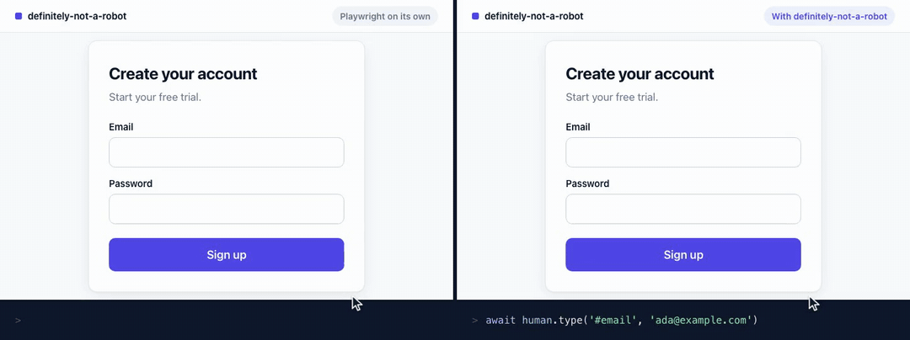

- **Every input, not just the cursor.** Mouse, keyboard and wheel, all humanized, in one library.
- **The real mouse, not a drawing of one.** Hover menus open on the way and drags arrive point by
  point, because the page gets every event along the path.
- **Any run, replayed exactly.** A seed reproduces a flaky test or re-records a demo frame for frame.

```bash
npm install definitely-not-a-robot
```

[](https://github.com/dougwithseismic/npm-definitely-not-a-robot/actions/workflows/ci.yml)
[](https://www.npmjs.com/package/definitely-not-a-robot)
[](#api)
[](package.json)
[](LICENSE)

## Quickstart

```js
import { chromium } from 'playwright'
import { createHuman } from 'definitely-not-a-robot'

const browser = await chromium.launch({ headless: false })
const page = await browser.newPage()
await page.goto('https://demo.playwright.dev/todomvc')

const human = createHuman(page)
await human.type('.new-todo', 'Buy milk')
await human.press('Enter')
await human.click('.toggle')

await browser.close()
```

Run it and watch: the cursor arcs over to the field, the text goes in key by key, and the
checkbox gets clicked a little off-centre, the way you'd click it.

Rather see it first? [The live demo](https://site-production-4098.up.railway.app) puts
Playwright's click next to a human one: click anywhere and both cursors go there.

### In Playwright Test

Change one import and every test gets a `human` next to `page`:

```ts
import { expect, test } from 'definitely-not-a-robot/playwright'

test('adds a todo', async ({ page, human }) => {
    await page.goto('https://demo.playwright.dev/todomvc')
    await human.type('.new-todo', 'Buy milk')
    await human.press('Enter')
    await expect(page.getByTestId('todo-title')).toHaveText('Buy milk')
})
```

Set options for a file with `test.use({ humanOptions: { preset: 'demo' } })`, or for every test
with `use: { humanOptions: { … } }` in `playwright.config.ts` (in TypeScript, write
`defineConfig<HumanFixtures>({ … })`, importing the type from here). Already have your own `test`?
Combine the two with Playwright's `mergeTests(yourTest, test)`. Everything in the main package is
exported here too, so one import covers it. Needs `@playwright/test` 1.40 or later.

### With Puppeteer

Pass a Puppeteer page instead. Nothing else changes:

```js
import puppeteer from 'puppeteer'
import { createHuman } from 'definitely-not-a-robot'

const browser = await puppeteer.launch({ headless: false })
const page = await browser.newPage()
await page.goto('https://demo.playwright.dev/todomvc')

const human = createHuman(page)
await human.type('.new-todo', 'Buy milk')
await human.press('Enter')
await human.click('.toggle')

await browser.close()
```

Targets are CSS selectors (Puppeteer's own `::-p-text(Sign up)` works too), element handles from
`page.$()`, or points. Same seed, same path, whichever tool drives the browser.

## Why

Playwright is built for speed. `click()` teleports the mouse to the exact centre of an element and
`fill()` pastes text in one go. That's perfect when a test only cares about the end result, and
wrong when your automation needs to look or behave like a person:

- **Demo videos look robotic.** The cursor jumps, and text appears all at once.
- **Bugs that need real input stay hidden.** Hover menus, debounced search boxes, drag and drop,
  and validation that runs on each keystroke only fire on the events a person produces.
- **Testing your own analytics, heatmaps or bot defences** needs sessions that move like users,
  not like scripts.

## What you get

- **Mouse paths that arc**, timed by Fitts's law: far, small targets take longer than near, big
  ones. Long moves sometimes overshoot and correct, and the hand has a slight tremor.
- **Clicks that land where people click**: near the centre, never the edge. They also refuse to
  click through a cookie banner or modal that's covering the target, and tell you what's in the way.
- **Typing with rhythm**: uneven gaps between keys, faster common letter pairs, pauses between
  words and sentences, Shift held for capitals, and optional typos that get noticed and fixed.
- **Wheel scrolling** in notches and bursts. Targets off-screen are scrolled into view before
  the cursor heads for them.
- **Hover, drag and drop, double-click, right-click and key combinations.**
- **A Playwright Test fixture**: import `test` from `definitely-not-a-robot/playwright` and every
  test gets a `human`.
- **A visible cursor for demo videos**: `preset: 'demo'` draws a cursor, with a ring on every
  press, into screenshots and `recordVideo` recordings. Headless browsers draw none of their own.
- **Seeds**: `createHuman(page, { seed: 42 })` replays identical paths and timings, so a flaky
  run can be reproduced and a demo video re-recorded frame for frame.
- **Instant mode for CI**: set `DNAR_SPEED=instant` and the same script runs at full speed. It
  sends the same kinds of events, with no waiting.
- **Built to extend**: presets, swappable motion, typing and scroll strategies, plugins, and
  custom drivers.
- **No dependencies.** TypeScript types included, ESM and CommonJS, Node 18+. Works with
  `playwright`, `playwright-core`, `@playwright/test` and `puppeteer`, and is tested in
  Chromium, Firefox and WebKit.

### See it

Every clip below was recorded by the library itself, with `preset: 'demo'` and Playwright's
`recordVideo`.

<table>
<tr><td width="50%" valign="top">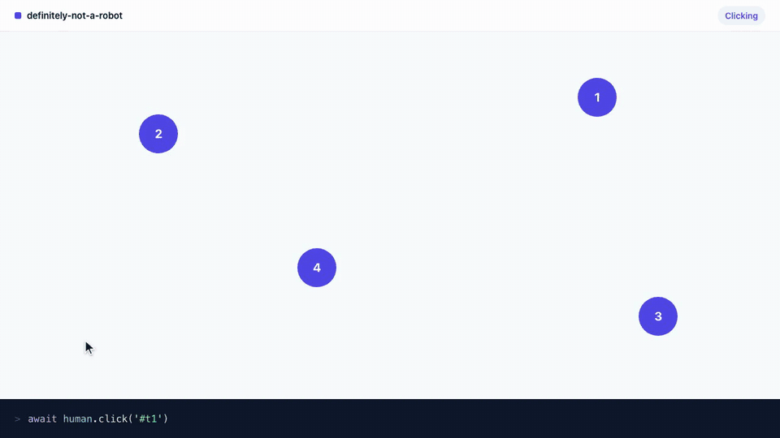<br>Curved paths, timed by distance and size, with an overshoot on long moves</td><td width="50%" valign="top">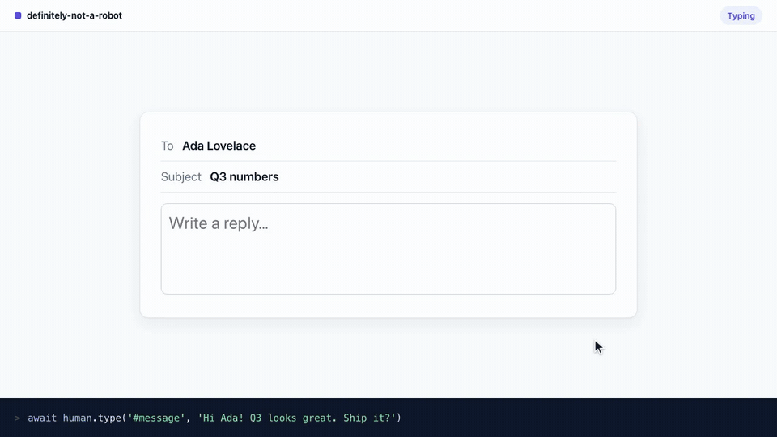<br>Typing with a rhythm, Shift for capitals, and a typo fixed on the spot</td></tr>
<tr><td width="50%" valign="top">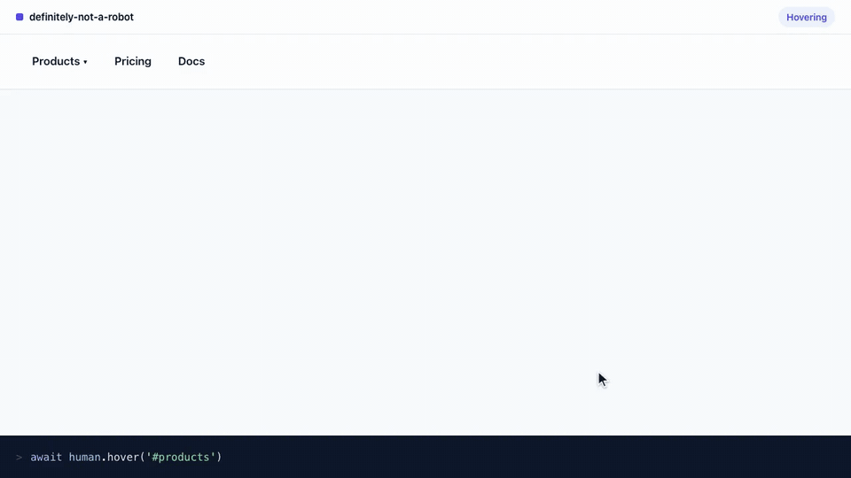<br>Hover opens menus on the way, then clicks inside them</td><td width="50%" valign="top">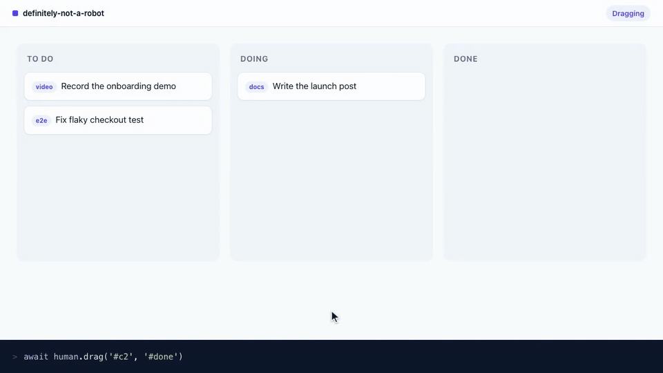<br>Drag and drop, holding the button the whole way</td></tr>
<tr><td width="50%" valign="top">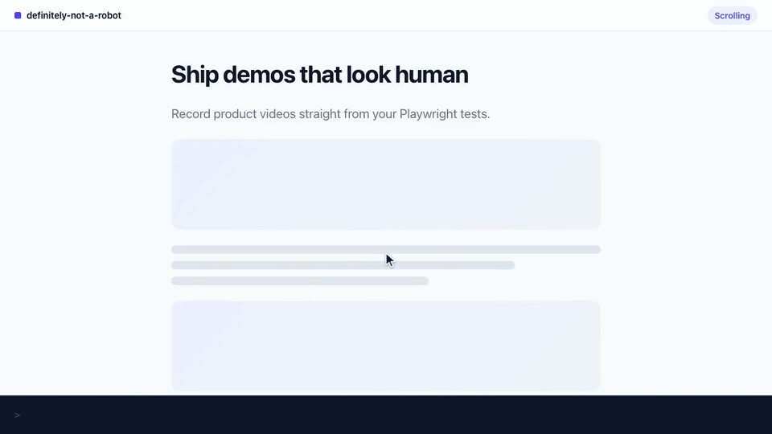<br>Off-screen targets are scrolled into view with the wheel, in bursts</td><td width="50%" valign="top">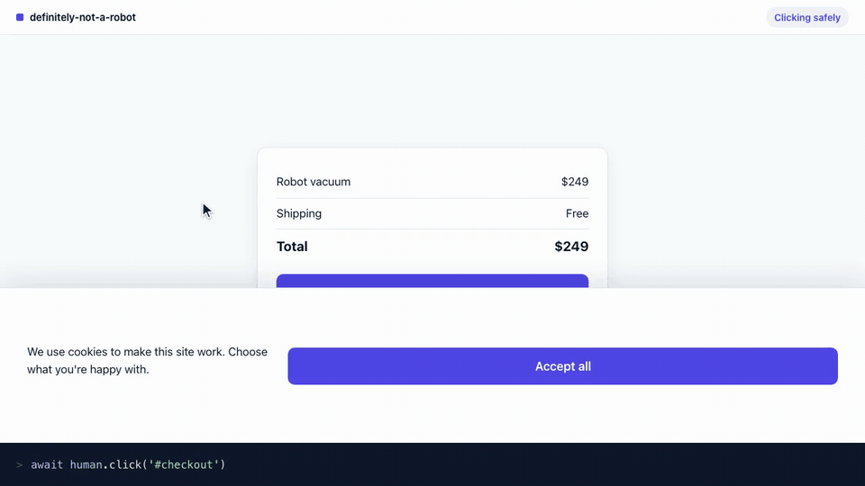<br>Won’t click through a cookie banner, and says what’s in the way</td></tr>
<tr><td colspan="2" valign="top">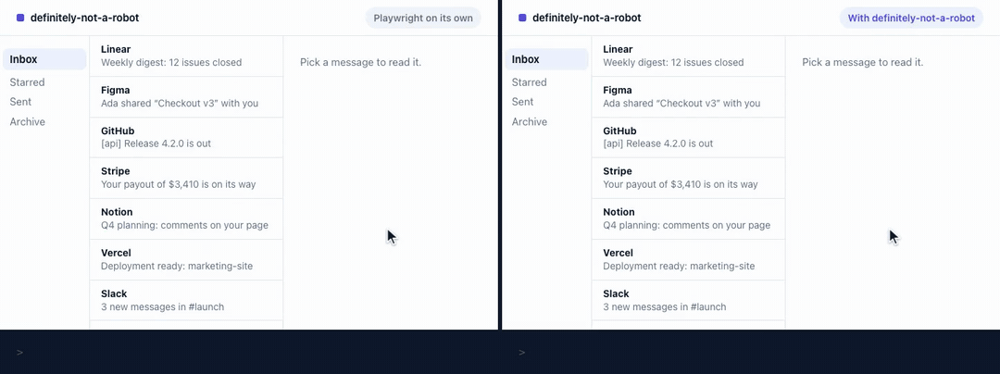<br>A message deep in a scrolling list. Left: Playwright jumps the list and the cursor there. Right: the cursor moves over the list and turns the wheel</td></tr>
<tr><td width="50%" valign="top">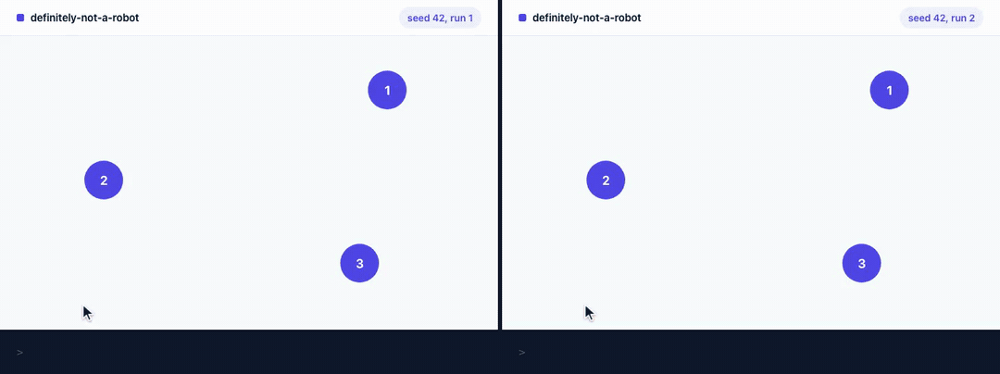<br>The same seed replays the same run, path for path</td><td width="50%" valign="top">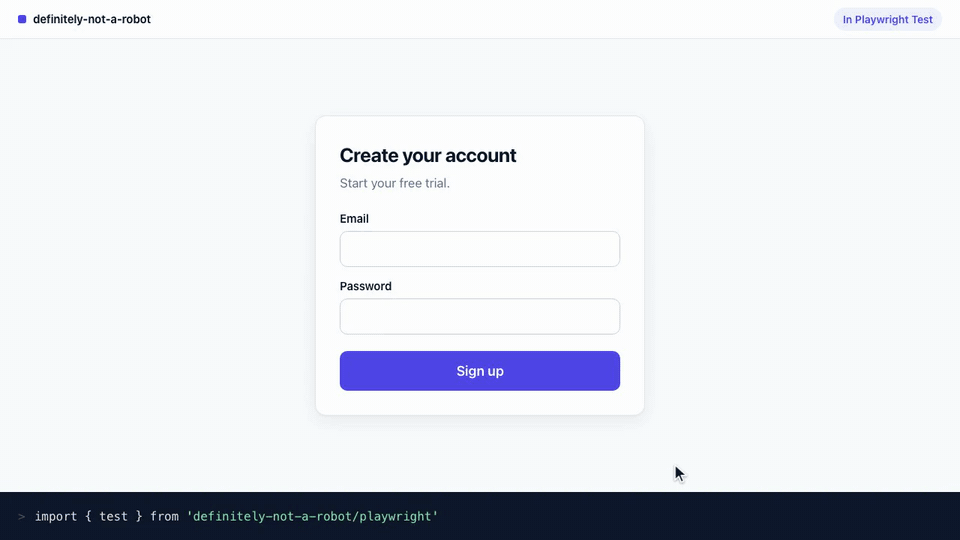<br>In Playwright Test: one import, and every test gets a human</td></tr>
<tr><td colspan="2" valign="top">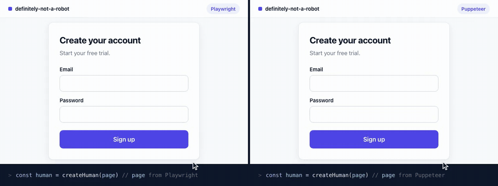<br>The same calls on a page from Playwright and a page from Puppeteer</td></tr>
</table>

## Use cases

Three jobs people bring it to. Each has a recipe in [`examples/`](examples) that runs in CI, and a
page on the website with a video of it.

- **[Product demos that look real](https://site-production-4098.up.railway.app/use-cases/demo-videos/).** Re-record a walkthrough from
  a script. The `demo` preset draws a cursor viewers can follow and types at a pace they can read.
  Recipe: [Record a demo video](#record-a-demo-video).
- **[Tests that need real input](https://site-production-4098.up.railway.app/use-cases/real-input-tests/).** Search-as-you-type,
  signature pads, drag and drop and per-keystroke checks wait for the events a person makes.
  `page.fill()` sends no key events and drags arrive in one jump; `human` sends them all. Recipe:
  [`examples/real-input.spec.ts`](examples/real-input.spec.ts).
- **[Checking your own analytics](https://site-production-4098.up.railway.app/use-cases/analytics-testing/).** Heatmaps, session replay
  and your own bot rules need sessions that move like visitors. Point seeded sessions at your
  staging site and run any one again with its seed. Recipe:
  [`examples/synthetic-sessions.mjs`](examples/synthetic-sessions.mjs).

<table>
<tr><td width="50%" valign="top">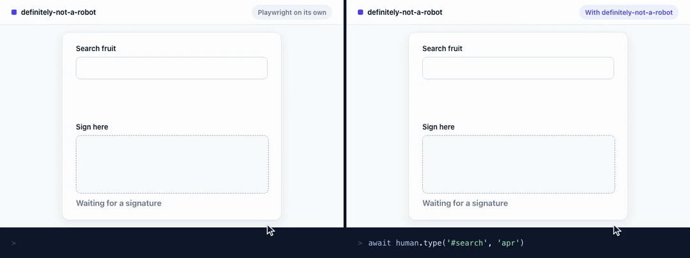<br><code>page.fill()</code> shows no suggestions and a dragged signature is too short; <code>human</code> gets both</td><td width="50%" valign="top">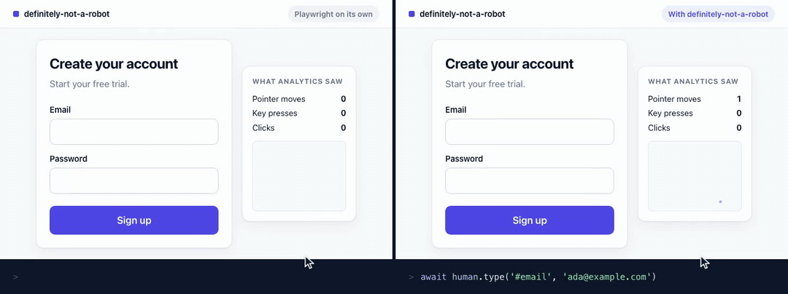<br>What an analytics script records from each sign-up: one pointer move and no keys, against a trail and every key</td></tr>
</table>

## API

```ts
const human = createHuman(page, options?)
```

Words like *target*, *preset*, *strategy*, *driver* and *Fitts's law* are explained in plain
language in the [glossary](docs/GLOSSARY.md).

| Method | What it does |
| --- | --- |
| `human.click(target, { button?, clickCount? })` | Moves to the target, hesitates, presses, holds, releases |
| `human.doubleClick(target)` | Two quick clicks the page sees as a double-click |
| `human.move(target)` | Moves along a curved path without clicking |
| `human.hover(target)` | Moves there and lingers, so menus and tooltips open |
| `human.drag(from, to)` | Presses on `from`, carries it along a human path, releases on `to` |
| `human.type(target, text, { clear? })` | Clicks the field and types at the end of what's there. `clear: true` replaces it |
| `human.type(text)` | Types into whatever has focus |
| `human.press(keys)` | A key or combination: `'Enter'`, `'Shift+Tab'`, `'ControlOrMeta+A'` |
| `human.scroll({ by })` / `human.scroll({ to })` | Wheel by pixels, or to an element, `'top'` or `'bottom'` |
| `human.pause()` / `human.pause(ms)` / `human.pause(min, max)` | Waits like a person thinking |
| `human.seed` | The seed in use. Log it to replay a run |
| `human.position` | Where the cursor is |

A **target** is a selector (`'#email'`, `'text=Sign up'`), a Playwright locator
(`page.getByRole('button', { name: 'Sign up' })`), an element handle, or a point
(`{ x: 200, y: 340 }`). Every action waits for its target to be visible, the way Playwright's
own actions do.

### Options

| Option | Default | What it does |
| --- | --- | --- |
| `preset` | `'average'` | `'average'`, `'careful'`, `'fast'` or `'demo'`, or your own preset object |
| `seed` | random | Replays identical movement and timing |
| `speed` | `1` | Multiplies every timing. `2` is twice as fast; `'instant'` skips waiting |
| `typing` | 65 wpm | `{ wpm, variance, typos }`, or your own typing strategy |
| `motion` | Bezier | `{ fitts, curvature, overshoot, tremor }`, or your own motion strategy |
| `scroll` | wheel | `{ notch, burst }`, or your own scroll strategy |
| `timing` | | `{ hesitation, hoverDwell, think, clickHold, doubleClickGap }` as `[min, max]` ms |
| `timeout` | `10000` | How long to wait for a target to appear, in ms |
| `plugins` | `[]` | Hooks that run around actions and cursor moves |
| `startPosition` | lower middle | Where the cursor starts |
| `driver` | detected | Wrap the built-in driver, or drive another tool |

### Presets

A preset bundles how someone moves, types and pauses. Pick one by name:

| Preset | Moves like | Typing | Good for |
| --- | --- | --- | --- |
| `average` (default) | Someone on a site they know | 65 wpm | Tests and synthetic sessions |
| `careful` | Someone reading as they go | 42 wpm, longer pauses before clicks | Slow, deliberate walkthroughs |
| `fast` | A power user | 95 wpm, short pauses | Quicker runs that still send every event |
| `demo` | A presenter | A steady 50 wpm, smooth moves, the cursor drawn | Recording videos |

Anything else you pass changes just that part of the preset, and `definePreset()` makes your own:

```js
import { createHuman, definePreset } from 'definitely-not-a-robot'

createHuman(page, { preset: 'careful', typing: { typos: 0.02 } }) // still 42 wpm, now with typos

const tired = definePreset({ typing: { wpm: 35, typos: 0.04 }, timing: { think: [1500, 4000] } })
createHuman(page, { preset: tired })
```

## Recipes

### Record a demo video

```js
import { chromium } from 'playwright'
import { createHuman } from 'definitely-not-a-robot'

const browser = await chromium.launch()
const context = await browser.newContext({
    viewport: { width: 1280, height: 720 },
    recordVideo: { dir: 'videos', size: { width: 1280, height: 720 } },
})
const page = await context.newPage()
await page.goto('https://demo.playwright.dev/todomvc')

const human = createHuman(page, { preset: 'demo' })
await human.type('.new-todo', 'Record the launch video')
await human.press('Enter')
await human.click('.toggle')
await human.pause()

await context.close() // the video is written when the context closes
console.log('Saved', await page.video().path())
await browser.close()
```

`preset: 'demo'` moves smoothly, types at a steady 50 words a minute and draws the cursor. The
cursor follows the page's real mouse events, so it shows exactly what the page received.
Playwright saves WebM; `ffmpeg -i videos/<file>.webm demo.mp4` makes an MP4. In Playwright Test,
set `use: { video: 'on', humanOptions: { preset: 'demo' } }` and use the `human` fixture.

To add the cursor to any other preset, restyle the demo one, or see the path the mouse took (your
`visibleCursor()` replaces the preset's):

```js
import { createHuman, trail, visibleCursor } from 'definitely-not-a-robot'

createHuman(page, { plugins: [visibleCursor({ color: '#e11d48', size: 28 }), trail()] })
```

Using `page.screencast.showActions()` for action titles as well? Pass `{ cursor: 'none' }` so only
one cursor is drawn.

### Run at full speed in CI

```bash
DNAR_SPEED=instant npx playwright test
```

The environment variable overrides `speed` in code, so the same script is human when you watch it
and fast when CI runs it. Nothing switches on its own: without it, CI runs at human speed, so
videos recorded there still look like a person. Instant mode skips `human.pause()` too, so wait
for the page with Playwright's `expect` or `waitFor`, not with a pause.

### Replay a run exactly

```js
const human = createHuman(page)
console.log('seed', human.seed) // e.g. 1842273

// Later, to reproduce it:
const replay = createHuman(page, { seed: 1842273 })
```

### Type faster, slower, or sloppier

```js
createHuman(page, { typing: { wpm: 90, typos: 0.02 } }) // a typo every 50 letters or so, fixed
createHuman(page, { typing: { variance: 0 } }) // a metronome: every gap the same
```

### Write your own motion

A strategy is just an object with a `plan` function that returns timed points. Here's a cursor
that moves in a straight line at constant speed:

```ts
import { createHuman, defineMotion } from 'definitely-not-a-robot'

const straight = defineMotion({
    name: 'straight',
    plan: ({ from, to }) =>
        Array.from({ length: 20 }, (_, i) => {
            const k = (i + 1) / 20
            return { x: from.x + (to.x - from.x) * k, y: from.y + (to.y - from.y) * k, t: i * 16 }
        }),
})

createHuman(page, { motion: straight })
```

Typing (`defineTyping`) and scrolling (`defineScroll`) work the same way.

### Hook into every action

```ts
import { createHuman, definePlugin } from 'definitely-not-a-robot'

const log = definePlugin({
    name: 'log',
    beforeAction: (action) => console.log('→', action.type, action.target ?? action.text ?? ''),
})

createHuman(page, { plugins: [log] })
```

### Drive something else

Everything that talks to the browser goes through a small `Driver` interface: mouse move, down
and up, wheel, key down and up, insert text, viewport, scroll offset, and finding an element.
Playwright and Puppeteer have one built in, picked from the page you pass. To change how input
reaches the browser, wrap the built-in one. This one logs every press:

```ts
import { createHuman, defineDriver, playwrightDriver } from 'definitely-not-a-robot'

const base = playwrightDriver(page)
const logged = defineDriver({
    ...base,
    mouseDown: (button, clickCount) => {
        console.log('press', button)
        return base.mouseDown(button, clickCount)
    },
})

createHuman(page, { driver: logged })
```

For another tool entirely, write every method with `defineDriver()` and pass it the same way.

## How it works

Every action is **planned, then played**. Planning is pure maths: a Bezier curve timed by Fitts's
law and eased the way an arm accelerates, a list of keystrokes with human gaps, a series of wheel
notches. Playing sends those steps to the browser on a clock. If the browser is slow or remote,
it drops points rather than running late, so a movement takes as long as a person would take.

All randomness comes from one seeded generator, which is why a seed replays a run exactly.
New to the terms? There's a plain-language [glossary](docs/GLOSSARY.md).

## Responsible use

This library makes **input** look human. It doesn't hide that a browser is automated, patch
fingerprints, or solve CAPTCHAs, and it isn't meant to get around anyone's bot protection. Use it
on sites you own or have permission to automate: demos, tests and research.

## FAQ

**Will this get me past bot detection?** No, and it isn't built to. Detection looks at the browser
itself, the network and behaviour over time, not only at how the mouse moves, and this library
changes nothing but how input is sent. Use it on sites you own or have permission to automate.

**My recorder already draws a cursor. Why do I need this?** A drawn cursor is painted on between
actions, while the real mouse still jumps, so hover menus never open along the way. This library
moves the real mouse along the whole path, and its own cursor follows the events the page
received. It works with any recorder.

**Does it work with `@playwright/test`?** Yes. Import `test` from
`definitely-not-a-robot/playwright` and every test gets a `human`, or pass the test's `page` to
`createHuman` yourself.

**Does it work with Puppeteer?** Yes. Pass a Puppeteer page to `createHuman` and every action
works as it does on Playwright. Use selectors or element handles as targets; Puppeteer's
`page.locator()` locators aren't supported yet.

**Why are my tests slower?** Human timing takes human time. Use `DNAR_SPEED=instant` in CI, or
`speed: 2` to halve it.

## Changelog

See [CHANGELOG.md](CHANGELOG.md).

## License

MIT © Doug Silkstone
